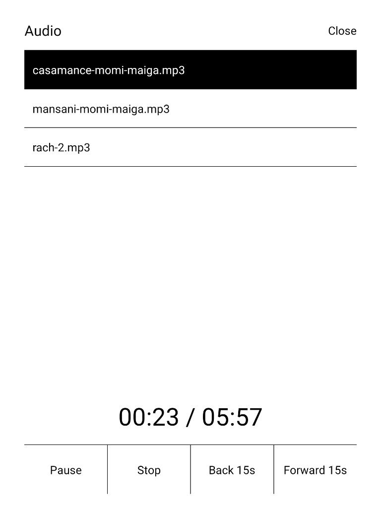

# Audio

Play MP3 and WAV files on a Supernote while a note or a PDF stays open.

Put the files in `Document/Audio`. A folder ends with `/`. Tap it to open it, and tap **Up** to leave. The list is read again each time Audio opens. Open a note or a document, tap **Audio**, and choose a file. The row that is playing is filled black. **Play** and **Pause** are the same control. **Stop** returns to the start. **Back 15s** and **Forward 15s** move within the file. The time advances once a second, and only while audio is playing.



**Close** returns to the page and leaves the audio running. Leaving the note with the screen still on does the same. Sleeping the screen pauses it and keeps the position. Disconnecting the headphones does too. Play resumes from there. Sound goes to the output already connected, such as Bluetooth headphones.

The headset play button toggles play and pause. A double tap with three fingers does the same: two short taps, without sliding, and with the pen off the page. One finger and two fingers stay with Supernote.

## Permission

The plugin asks for read access. Choose **Always allow**. **Allow this time only** ends when the player closes or the screen sleeps, and the next read then fails until it is granted again. The plugin only reads `Document/Audio`.

## Install

Copy `SnAudio.snplg` to `MyStyle`. On the device, open Settings → Apps → Plugins → Add Plugin and select it.

## Build

On Linux, with the Supernote plugin SDK, Node 22, JDK 21, and Android SDK 35:

```sh
./buildPlugin.sh
```

The package is `build/outputs/SnAudio.snplg`.

## License

[MIT](LICENSE) © 2026 Germán Puerto
